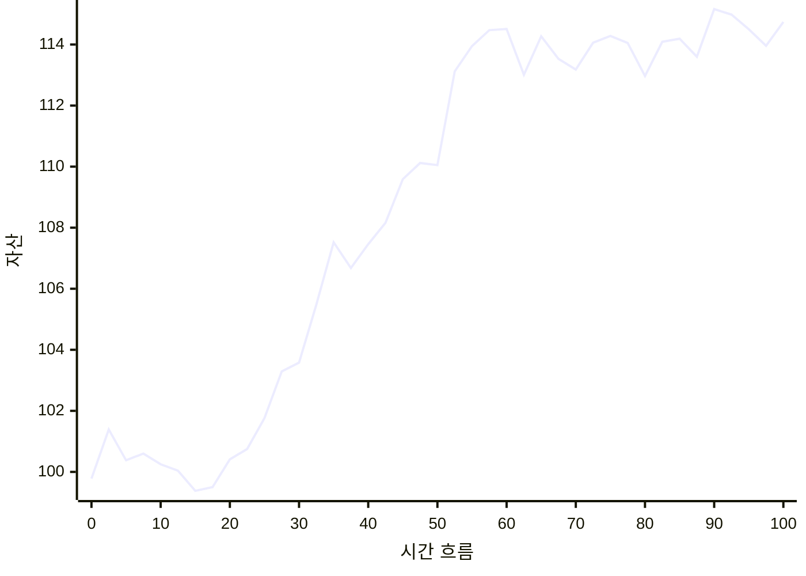

# 🧬 진화형 트레이딩 AI 리포트

_마지막 실행: 2026-11-18 20:35 KST · 1일차 · 누적 300세대 · 계산 75초_

> 모의투자 실험입니다. 실제 주문은 하지 않습니다.
> 점수는 모두 **AI가 학습에 쓰지 않은 가장 최근 8.0일(시험 구간)** 기준입니다.

## 오늘의 결과

| | 시험 구간 수익률 | 거래 횟수 |
|---|---|---|
| 👑 챔피언 `G300-D1` | **+14.74%** | 1 |
| 🥊 오늘의 도전자 | +14.74% | 1 |
| 그냥 보유 | -13.55% | 1 |
| 아무것도 안 함 | +0.00% | 0 |

- 결과: **첫 챔피언 등장**
- 챔피언이 보는 정보 3개 중 가장 중요하게 쓰는 것: 변동성 수준, 1일 변화, 시간대 (cos)

## 챔피언 시험 구간 자산 변화 (시작 = 100)


## 날짜별 챔피언 성적 (최근 30일, %)
```mermaid
xychart-beta
    x-axis "일차" 1 --> 2
    y-axis "시험 구간 수익률 %"
    line [14.74]
```

| 일차 | 날짜 | 누적 세대 | 챔피언 수익률 | 그냥 보유 | 거래 | 결과 |
|---|---|---|---|---|---|---|
| 1 | 2026-11-18 | 300 | +14.74% | -13.55% | 1 | 교체 |
