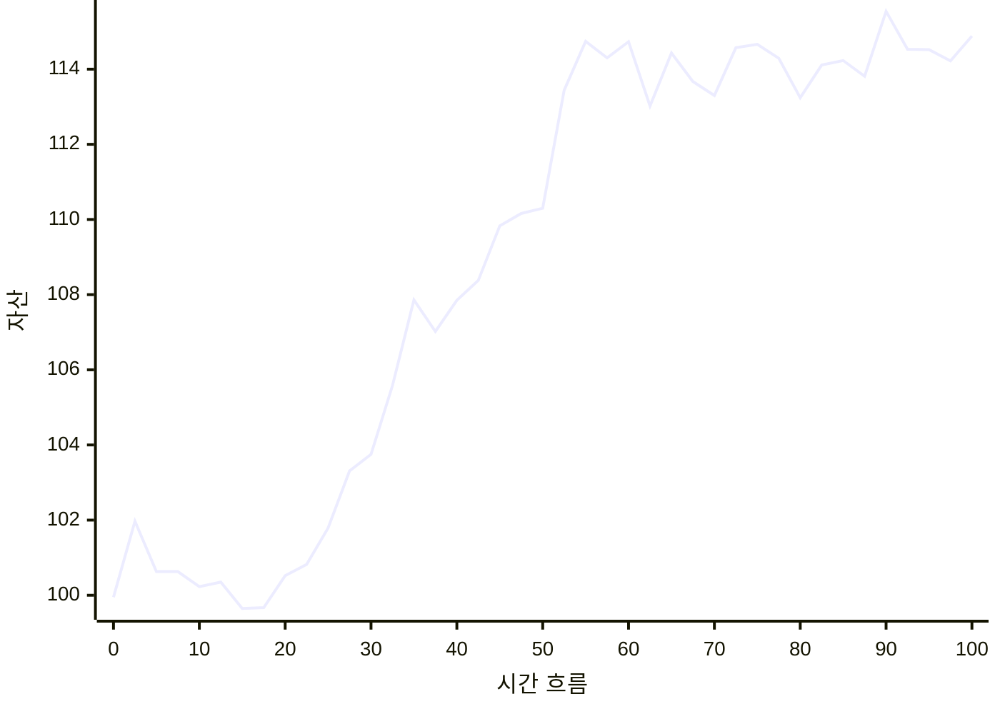
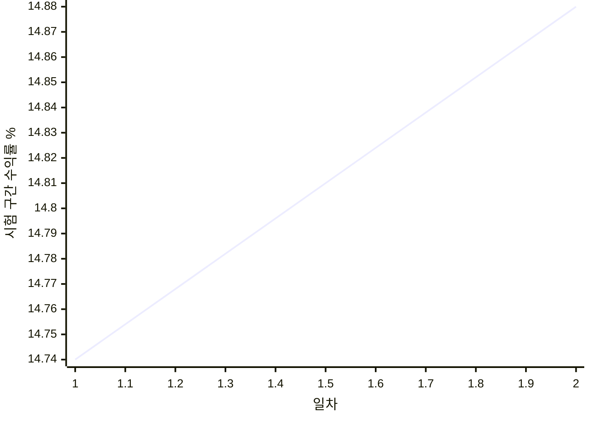

# 🧬 진화형 트레이딩 AI 리포트

_마지막 실행: 2026-11-18 20:40 KST · 2일차 · 누적 600세대 · 계산 39초_

> 모의투자 실험입니다. 실제 주문은 하지 않습니다.
> 점수는 모두 **AI가 학습에 쓰지 않은 가장 최근 8.0일(시험 구간)** 기준입니다.

## 오늘의 결과

| | **점수** | 수익률 | 손실 보유 감점 | 최대 손실 상태 | 거래 |
|---|---|---|---|---|---|
| 👑 챔피언 `G300-D1` | **+13.78** | +14.88% | -0.09 | -0.66% | 1 |
| 🥊 오늘의 도전자 | +13.78 | +14.88% | -0.09 | -0.66% | 1 |
| 그냥 보유 | - | -13.61% | - | - | 1 |
| 아무것도 안 함 | +0.00 | +0.00% | 0 | 0% | 0 |

> **점수 = 수익률(로그) − 손실 보유 감점.** 포지션을 잡고 손실 상태로 버틴 시간만큼 깎입니다
> (예: 2% 손실 상태로 하루 버티면 −2점). 챔피언 교체도 이 점수로 결정합니다.

- 결과: **챔피언 방어 성공**
- 챔피언이 보는 정보 3개 중 가장 중요하게 쓰는 것: 변동성 수준, 1일 변화, 시간대 (cos)

## 챔피언 시험 구간 자산 변화 (시작 = 100)

## 날짜별 챔피언 성적 (최근 30일, %)

| 일차 | 날짜 | 누적 세대 | 챔피언 점수 | 챔피언 수익률 | 그냥 보유 | 거래 | 결과 |
|---|---|---|---|---|---|---|---|
| 2 | 2026-11-18 | 600 | +13.78 | +14.88% | -13.61% | 1 | 유지 |
| 1 | 2026-11-18 | 300 | +nan | +14.74% | -13.55% | 1 | 교체 |
